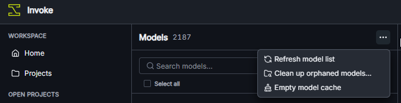

# Invoke Tool Suite

A desktop app with two tools for InvokeAI:

- **Image Transfer** uploads images from a v6 backup into a v7 project and board.
- **CivitAI** finds missing trigger words and thumbnails for installed LoRAs and checkpoints.

Keep InvokeAI running and enter its API address on the Home tab. Source v6 files are read locally; changes to v7 are sent through Invoke's API.

After the CivitAI tool finishes, refresh the model list in InvokeAI: open the three-dot menu at the top of the Models list and choose **Refresh model list**.



## Warning

This tool is vibecoded and may contain bugs. API operations do not create a database backup. Make your own backup before using it. Use it at your own risk.

## Run

Install [Node.js](https://nodejs.org/) and the [Rust toolchain](https://www.rust-lang.org/tools/install), then run:

```powershell
npm install
npm run desktop
```

To build a packaged desktop app:

```powershell
npm run desktop:build
```
